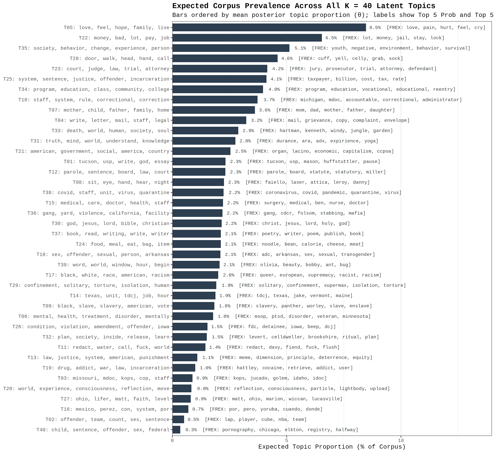
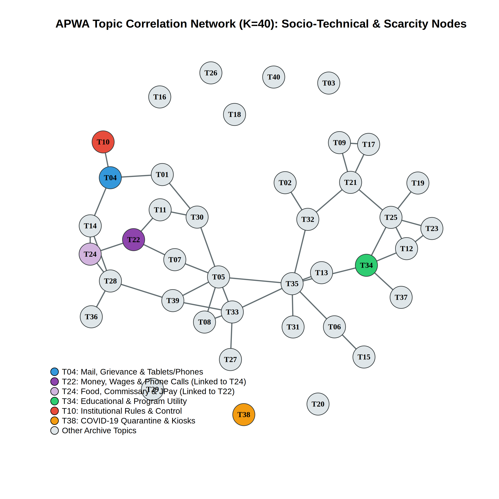
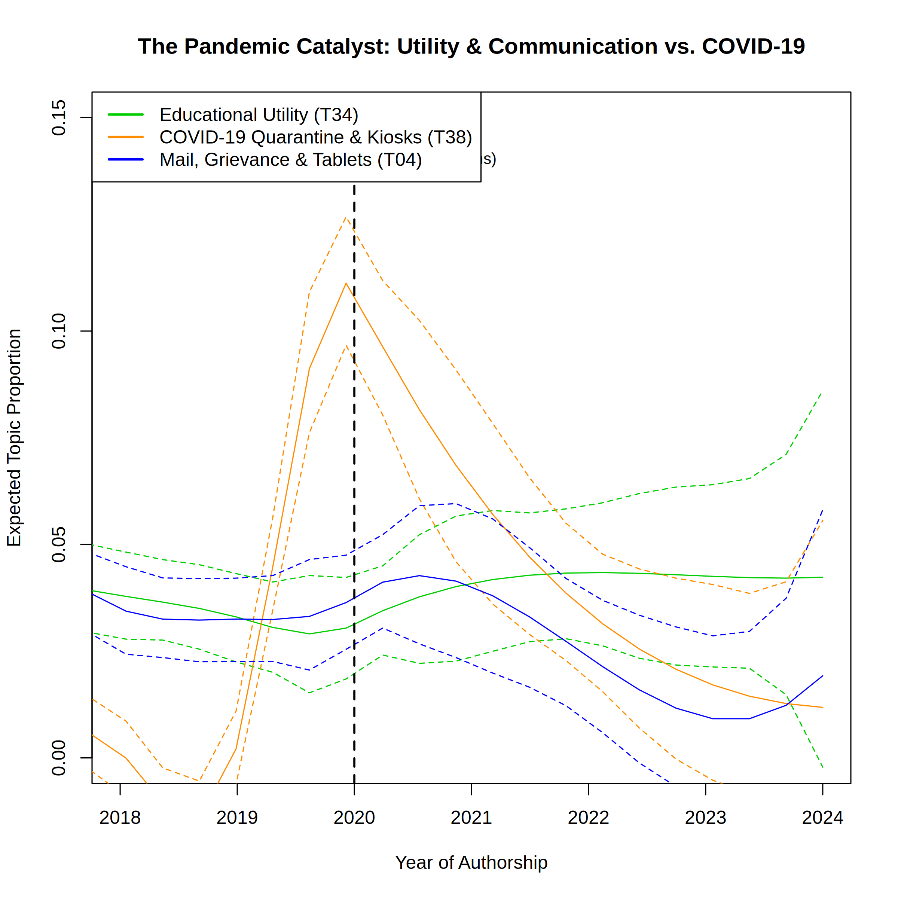
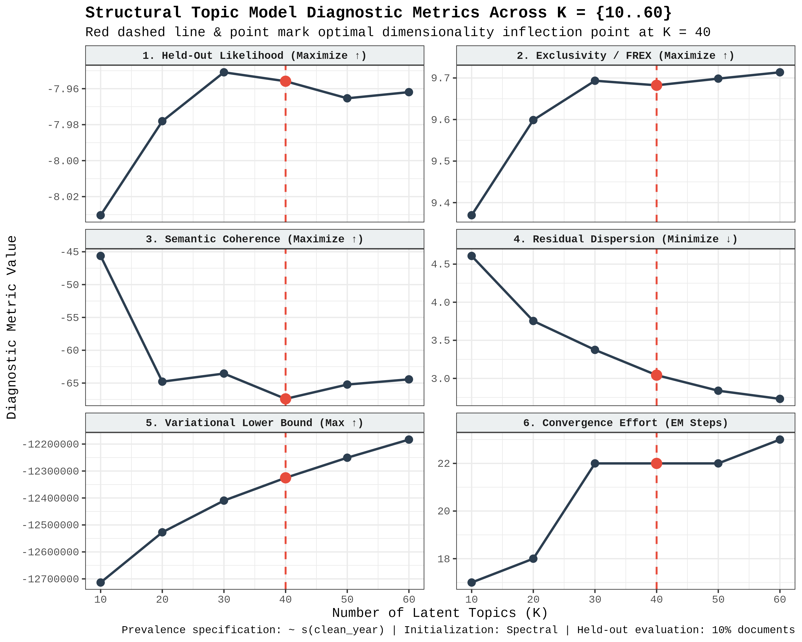

# Prefiguring the Carceral-Digital Turn: A Computational Linguistic Analysis of the American Prison Writing Archive (APWA)

[](https://colab.research.google.com/github/chayne-wild/APWA-Scrape-and-STM/blob/main/APWA_Scrape_and_STM.ipynb)


An end-to-end web scraping, Natural Language Processing (NLP), and **Structural Topic Modeling (STM)** replication pipeline analyzing **3,713 temporally normalized essays** (**1,013,949 tokens** across **24,845 unique vocabulary lemmas**) from the American Prison Writing Archive (APWA).

Built for **Google Colaboratory** using an integrated Python-to-R `rpy2` (`%%R`) bridge, this repository provides a unified, deterministic, and checkpointed sequential replication notebook (`APWA_Scrape_and_STM.ipynb`) spanning data acquisition (`00`–`02`), vectorized Tidyverse NLP preprocessing (`03`), hyperparameter tuning (`04`), spectral STM estimation (`05`), $\beta$-matrix lexical auditing and qualitative exemplar extraction (`06`), temporal regression modeling (`07`–`08`), network analysis (`09`), and automated artifact routing (`10`).

---

## 1. Project Overview & Research Question

**Driving Research Question:** *How have incarcerated writers in the American Prison Writing Archive (APWA) discussed and documented the "carceral-digital turn," and how is emerging digital technology embedded within preexisting carceral infrastructures?*

The "carceral-digital turn" refers to the rapid introduction of proprietary digital tablets, electronic messaging kiosks (e.g., JPay, GTL/ViaPath, Securus, CorrLinks), and electronic surveillance into U.S. correctional facilities. Mainstream academic consensus—largely codified around **2021**—characterizes this technological shift through a dual frame: **the commodification of connection** (extracting wealth from incarcerated people and their families under the guise of rehabilitation) and **the expansion of carceral control** (intensifying institutional surveillance, mail censorship, and disciplinary regulation).

This project tests the **Prefiguration & Socio-Technical Embedding Hypothesis**: the proposition that incarcerated intellectuals and writers were actively documenting and critiquing the structural mechanics of the carceral-digital turn prior to its 2021 codification in outside scholarship, experiencing digital tools not as autonomous "virtual" spaces, but as extensions of mail censorship, commissary scarcity, educational programming, and quarantine lockdowns.

---

## 2. Summary of Key Empirical Findings

Using unsupervised **Structural Topic Modeling (STM)** ($K = 40$, Spectral initialization, prevalence covariate `~ s(clean_year)`) on **3,713 temporally normalized essays** (1965–2026) from the APWA, paired with a direct **$\beta$-Matrix Lexical Audit**, B-spline temporal regressions, and `igraph` network correlation analysis, this study establishes four primary findings:



### 1. Socio-Technical Embedding in Unsupervised Topic Space ($\beta$-Matrix Audit)
Across a 50-year archive of 3,713 essays, specific proprietary hardware and vendor terms (`tablet` = 61 docs; `kiosk` = 29 docs; `jpay` = 19 docs; `securus` = 10 docs; `gtl` = 9 docs; `electronic` = 98 docs; `digital` = 48 docs; `camera` = 193 docs; `monitor` = 179 docs) do not occur in a vacuum. Querying the converged $40 \times 24,845$ topic-word probability matrix ($\beta$) reveals that incarcerated writers embed digital hardware directly inside four functional carceral regimes (see [`results/charts/tab03_tech_vocabulary_beta_audit.csv`](results/charts/tab03_tech_vocabulary_beta_audit.csv)):
* **Topic 04 (`T_CONNECTION` — Interpersonal Communication, Mail Censorship, & Tablets; 2.4% corpus share):**
  * *Top Prob:* `write, letter, mail, staff, legal, file, grievance` | *Top FREX:* `mail, grievance, copy, complaint, envelope, letter, confiscate`
  * *$\beta$-Matrix Tech Share:* Topic 04 holds the **#1 highest probability share in the entire 40-topic model** for `mail` (**61.3%**), `tablet` (**43.1%**), `letter` (**40.2%**), `camera` (**23.7%**), `surveillance` (**23.7%**), `digital` (**19.5%**), `electronic` (**17.3%**), `phone` (**16.8%**), and `monitor` (**13.4%**). Incarcerated authors overwhelmingly theorize tablets, electronic messaging, and cameras in the context of mailroom confiscation, institutional surveillance, and filing administrative grievances.
* **Topic 34 (`T_UTILITY` — Educational & Programmatic Utility; 2.9% share) & Topic 32 (`T_REENTRY` — Reentry Planning; 2.7% share):**
  * *T34 Top Prob:* `program, education, class, community, college, release, society` | *Top FREX:* `program, education, vocational, educational, reentry, student, college`
  * *$\beta$-Matrix Tech Share:* Topic 34 holds **52.2%** of `program` and **50.7%** of `education`, and serves as the **#2 dominant topic** for both `tablet` and `technology` (while Topic 32 holds the **#1 share** for `technology` at **16.4%**).
* **Topic 10 (`T_SURVEILLANCE` — Institutional Control & Bureaucratic Rules; 2.9% share) & Topic 29 (Solitary Confinement & Spatial Control; 2.7% share):**
  * *T10 Top Prob:* `staff, system, rule, correctional, correction, department, facility` | *Top FREX:* `michigan, mdoc, accountable, correctional, administrator, rule, correction`
  * Captures the administrative rulebooks, disciplinary tickets, and security classifications (`security`, `control`) through which carceral governance operates. *(Crucially, the $\beta$-audit also isolates a major statutory confound: `internet` and `online` concentrate in **Topic 40** [`child, sentence, offender, sex, federal`], reflecting pre-incarceration federal cyber-statutes rather than in-prison internet access).*

### 2. The Economy of Scarcity (Lexical Co-Location & Network Analysis)
Mapping the macro-structure of the archive via `stm::topicCorr` and `igraph` alongside the $\beta$-matrix audit reveals how telecom extraction intersects with material deprivation:
* **Lexical Embedding of Telecom Vendors in Commissary & Wage Topics:**
  * **Topic 24 (`T_COMMISSARY` — Food Provision & Commissary; 1.6% share):** `food, meal, eat, bag, item, serve, water` (*FREX:* `noodle, bean, calorie, cheese, meat, ounce, meal`). Topic 24 holds **41.6% of all corpus probability weight for `jpay`** (#1 topic in the archive) and is the **#2 dominant topic** for `gtl` and `electronic`.
  * **Topic 22 (`T_ECONOMY` — Carceral Economy, Wages & Phone Costs; 3.2% share):** `money, bad, lot, pay, job, call, jail` (*FREX:* `lot, money, jail, stay, lock, pay, job`). Topic 22 holds `call` at **Rank #6** and `phone` at **Rank #40**.
* **Statistical Coupling:** A document-level Pearson correlation test on the posterior $\theta$ matrix confirms a **statistically significant positive coupling** between **Topic 24 (Food/Commissary/JPay)** and **Topic 22 (Money/Wages/Phone Calls)** ($r = +0.0421, t = 2.565, \mathbf{p = 0.0104^*}$), and a significant structural trade-off between **Topic 04 (Mail/Grievances/Tablets)** and **Topic 22 (Money/Costs)** ($r = -0.0419, t = -2.554, \mathbf{p = 0.0107^*}$). Incarcerated writers experience JPay, GTL, and phone calls as direct financial competitors to basic nutrition and commissary survival.



### 3. The Pandemic Catalyst: COVID-19 Quarantine & Unit Kiosks (`Topic 38`)
* **Topic 38 (`T_COVID` — COVID-19 Pandemic & Lockdowns; 1.7% share):** `covid, staff, unit, virus, quarantine, pandemic, test` (*FREX:* `coronavirus, covid, pandemic, quarantine, virus, mask, corona`).
* **Unit Kiosks as Quarantine Lifelines:** The $\beta$-matrix audit reveals that **Topic 38 holds 43.0% of the entire archive's probability mass for `kiosk`** (#1 topic in the model) and is the **#2 dominant topic** for `telephone` and `screen`. When physical visitation and classrooms were suspended during the 2020 lockdowns, the housing-unit kiosk and telephone became the central infrastructural flashpoints of quarantine life.
* **Micro-Document Bifurcation:** Regressing and correlating `T38` (COVID-19) against `T34` (Educational Utility) across the $\theta$ matrix reveals a marginal negative correlation ($r = -0.0312, t = -1.904, p = 0.0570$), indicating that acute bio-security crisis reporting and rehabilitative educational programming operated as distinct, competing discursive spaces during the pandemic.



---

## 3. Methodological Architecture & Justification of $K = 40$

### Strict Language Partitioning (Python + R via `rpy2`)
To guarantee computational reproducibility and adherence to **Tidy Data Principles**, the pipeline is partitioned by language:
* **Python (Data Acquisition Only — Scripts `01` & `02`):** Used exclusively for dynamic pagination verification, polite rate-limited web scraping, DOM structural partitioning (`\nDetails\n` and `\nTranscript\n`), and raw JSONL serialization. **Zero** text cleaning or regex filtering occurs in Python.
* **R / Tidyverse (Preprocessing, NLP, & STM Modeling — Scripts `03`–`09`):** Used for fault-tolerant JSONL ingestion (`purrr::safely`), deterministic alphabetical `slug` sorting, 4-digit year normalization (`clean_year`), vectorized unique-type `tidytext` tokenization, domain-guarded `lexicon::hash_lemmas` lemmatization, the "Plural Bypass" stop-word filter, spectral STM estimation, Dynamic Semantic Topic Resolution, regression modeling, and `gt`/`ggplot2`/`igraph` visualization.

### Empirical & Substantive Justification of $K = 40$
Candidate models were evaluated across $K \in \{10, 20, 30, 40, 50, 60\}$ using a deterministic 10% held-out document split (`seed = 42`, `prevalence = ~ s(clean_year)`):



* **Statistical Plateau & Residual Reduction:** Out-of-sample held-out log-likelihood and FREX exclusivity exhibit steep gains from $K = 10$ ($\text{held-out} = -8.0303, \text{FREX} = 9.370$) to $K = 30$ ($-7.9509, \text{FREX} = 9.693$), flattening into a structural plateau between $K = 30$ and $K = 40$ ($-7.9559, \text{FREX} = 9.682$; a $<0.1\%$ divergence). Within this $K \in [30, 40]$ optimal window, expanding to $K = 40$ reduces unexplained **Residual Dispersion by a further 9.8% ($3.37 \rightarrow 3.04$)** and improves the variational lower bound by **+84,512** in the exact same convergence horizon (`22` EM iterations), before held-out likelihood degrades at $K = 50$ ($-7.9653$).
* **Substantive Validation:** At $K = 30$, distinct carceral phenomena remain conflated (e.g., Spanish-language texts are merged with English religious practice, and themes such as carceral financial extraction and military veteran PTSD remain submerged). Conversely, $K = 50$ and $K = 60$ induce over-fitting, fracturing unified themes (religion, food, consciousness) into duplicate topics and single-author name clusters.

---

## 4. Repository Structure

```text
APWA-Scrape-and-STM/
├── APWA_Scrape_and_STM.ipynb          # Complete end-to-end Colab replication notebook (00 -> 10)
├── README.md                          # Main project overview, findings, and methodology
├── data/
│   ├── README.md                      # Data dictionary, RDS schemas, and archival governance
│   ├── apwa_master_urls.csv           # 4,550 indexed essay URLs across 182 archive pages
│   ├── apwa_excluded_urls.csv         # 836 untranscribed PDF/scan-only URLs logged during scrape
│   ├── apwa_clean_corpus.rds          # 3,713 temporally normalized & lemmatized essays (1:1 aligned)
│   ├── apwa_stm_out_object.rds        # Synchronized STM matrix (3,713 docs, 24,845 lemmas, 1,013,949 tokens)
│   ├── apwa_searchK_results.rds       # Checkpointed hyperparameter tuning diagnostics (K = 10..60)
│   ├── apwa_stm_model_k40_final.rds   # Final converged K = 40 Spectral STM object
│   └── resolved_target_topics_k40.rds # Dynamically resolved socio-technical topic mapping
└── results/
    ├── README.md                      # Detailed guide to all figures, tables, and statistical logs
    ├── session_info.txt               # Exported R sessionInfo() environment specifications
    ├── charts/                        # Publication-ready CSV & GT HTML tables + exemplar essays
    └── figures/                       # High-resolution (300 DPI) diagnostic, trajectory, & network plots
```

---

## 5. Ethical & Institutional Compliance

The APWA is hosted by Johns Hopkins University (`prisonwitness.org`) with the mission of bearing witness to the lived reality of incarceration. Because incarcerated authors write under conditions of vulnerability and surveillance, our extraction and storage protocol prioritizes ethical non-interference, copyright respect, and server politeness:
* **`robots.txt` & Terms of Service Compliance:** Verified against [https://prisonwitness.org/robots.txt](https://prisonwitness.org/robots.txt) (`Allow: /`) and the Johns Hopkins University Library Privacy Policy. No unlisted Personally Identifiable Information (PII) was collected.
* **Polite Bot Identification & Rate Limiting:** All HTTP requests transmitted an explicit academic `User-Agent` header (`APWA_Virginia_Tech_Research_Bot/1.0 (chayne@vt.edu)`) with randomized delays (`1.5`–`3.0s` for index pages; `MAX_WORKERS = 4` with `0.5`–`1.5s` per-thread pauses for essays) and state-tracking resume logic.
* **Raw JSONL Purge (`Step 10A`):** Once the 1:1 aligned R mathematical matrices (`apwa_clean_corpus.rds` and `apwa_stm_out_object.rds`) are verified on Google Drive, the raw bulk scrape file (`apwa_parsed_archive.jsonl`) is automatically purged to prevent redistributing raw bulk transcripts in public Git version control.

### Archival Snapshots (Wayback Machine)
* **APWA Main Page:** [https://web.archive.org/web/20260915215456/https://prisonwitness.org/](https://web.archive.org/web/20260915215456/https://prisonwitness.org/)
* **APWA About Page:** [https://web.archive.org/web/20260915215555/https://prisonwitness.org/about-the-archive/](https://web.archive.org/web/20260915215555/https://prisonwitness.org/about-the-archive/)
* **JHU Library Privacy Policy:** [https://web.archive.org/web/20260915215139/https://www.library.jhu.edu/policies/privacy/](https://web.archive.org/web/20260915215139/https://www.library.jhu.edu/policies/privacy/)

---

## 6. Suggested Citation

**Text Citation (APA / ASA Style):**
> Wild, Chayne. 2026. *Prefiguring the Carceral-Digital Turn: A Computational Linguistic Analysis of the American Prison Writing Archive (APWA)* (Version 1.0.0) [Computer software]. Virginia Tech. https://github.com/chayne-wild/APWA-Scrape-and-STM

**BibTeX:**
```bibtex
@software{wild2026apwa,
  author       = {Wild, Chayne},
  title        = {Prefiguring the Carceral-Digital Turn: A Computational Linguistic Analysis of the American Prison Writing Archive (APWA)},
  year         = {2026},
  month        = {11},
  version      = {1.0.0},
  organization = {Alliance for Social, Political, Ethical, and Cultural Thought (ASPECT), Virginia Tech},
  url          = {https://github.com/chayne-wild/APWA-Scrape-and-STM},
  note         = {Replication code and Structural Topic Modeling (STM) pipeline}
}
```

**Archival Source Attribution:**
> American Prison Writing Archive (APWA). Johns Hopkins University Sheridan Libraries. [https://prisonwitness.org/](https://prisonwitness.org/)

---
